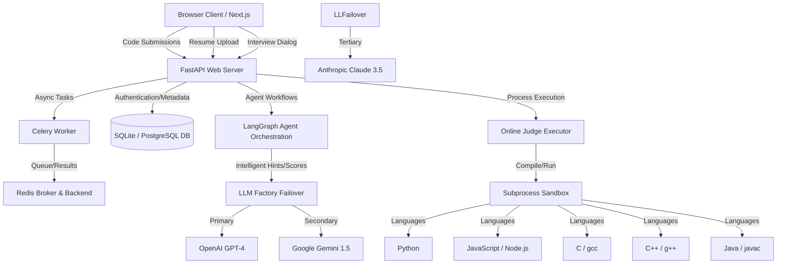

# Placement Preparation Agent Platform

An AI-powered technical placement training platform combining a stateful mock interview dialog engine, an adaptive recommendation system, resume skill scanners, and an online judge with compiler support.

---

## Architecture Overview



---

## Directory Structure

```
├── backend/
│   ├── app/
│   │   ├── services/
│   │   │   ├── executor.py       # Process sandboxing code runner (Python, JS, C, C++, Java)
│   │   │   └── agents.py         # LangGraph state machine & LLM factory failover
│   │   ├── database.py           # SQLAlchemy database interface & ORM config
│   │   ├── models.py             # User, Submission, Session, and Resume DB schemas
│   │   ├── worker.py             # Celery task configurations
│   │   └── main.py               # FastAPI routers, CORS controls, and Resume API
│   ├── tests/
│   │   ├── test_executor.py      # Process sandbox validation tests
│   │   └── test_resume.py        # Resume upload and parsing tests
│   ├── Dockerfile                # Configures GCC, G++, JDK, and Node for containerized runs
│   ├── requirements.txt          # Python package requirements
│   └── seed.py                   # Auto-seeding catalog script
├── frontend/
│   ├── app/
│   │   ├── globals.css           # Premium theme variables & styles
│   │   ├── layout.tsx            # Global Navigation Sidebar
│   │   ├── page.tsx              # Analytics dashboard & Resume Upload Widget
│   │   ├── practice/             # Code Editor practice view
│   │   └── interview/            # Mock Interview screen
│   ├── Dockerfile                # Next.js node application container config
│   ├── next.config.js
│   └── package.json              # Frontend package requirements
└── docker-compose.yml            # Multi-service container orchestration config
```

---

## System Requirements & Prerequisites

To run this platform locally, make sure you have the following installed:
- **Python**: Python 3.10 or 3.11
- **Node.js**: Node 18 or later (with `npm`)
- **Compilers (Optional on host, built into Docker)**:
  - `gcc` and `g++` (for C and C++ execution)
  - `default-jdk` / Java runtime (for Java execution)
- **Docker**: Docker Desktop (for the containerized run path)

---

## LLM Configuration

Create a `.env` file in the `backend/` directory from `.env.example` to enable smart interview agents:
```ini
OPENAI_API_KEY=your_openai_api_key
ANTHROPIC_API_KEY=your_anthropic_api_key
GEMINI_API_KEY=your_gemini_api_key
```
*Note: If no API keys are provided, the system automatically falls back to a rule-based mock dialogue interviewer agent, allowing offline verification.*

---


## Execution Path 1: Local Setup (Windows PowerShell)

Ensure you run these commands from the root directory of the project in PowerShell.

### 1. Backend Environment Setup & Seeding
```powershell
# Create Python virtual environment
python -m venv venv

# Activate virtual environment
. .\venv\Scripts\Activate.ps1

# Upgrade pip & install backend packages
python -m pip install --upgrade pip
pip install -r backend/requirements.txt

# Run Python verification tests
$env:PYTHONPATH="backend"
python -m pytest -o pythonpath=backend backend/tests/
```

### 2. Launch FastAPI Server
```powershell
# Start web server with hot-reload
$env:PYTHONPATH="backend"
python -m uvicorn app.main:app --port 8000 --reload
```
*The database automatically creates and seeds 250+ algorithm challenges on initial startup. API Docs are accessible at `http://localhost:8000/docs`.*

### 3. Launch Next.js Frontend
Open a new PowerShell terminal:
```powershell
cd frontend
npm install
npm run dev
```
*The frontend application will boot at `http://localhost:3000`.*

---

## Execution Path 2: Local Setup (Linux / macOS Bash)

Ensure you run these commands from the root directory of the project in your terminal.

### 1. Backend Environment Setup & Seeding
```bash
# Create and activate Python virtual environment
python3 -m venv venv
source venv/bin/activate

# Upgrade pip & install requirements
python -m pip install --upgrade pip
pip install -r backend/requirements.txt

# Run pytest suites
export PYTHONPATH="backend"
python -m pytest -o pythonpath=backend backend/tests/
```

### 2. Launch FastAPI Server
```bash
export PYTHONPATH="backend"
python -m uvicorn app.main:app --port 8000 --reload
```

### 3. Launch Next.js Frontend
Open a new terminal session:
```bash
cd frontend
npm install
npm run dev
```

---

## Execution Path 3: Containerized Setup (Docker Compose)

The easiest path to run the entire stack with C, C++, Java, JS, and Python execution environments fully configured. Run from the workspace root:

```bash
# Build and boot all containers
docker compose up --build
```

This starts:
- **Frontend** at `http://localhost:3000` (Next.js client)
- **Backend** at `http://localhost:8000` (FastAPI + compilers + JDK)
- **Database** at `localhost:5432` (PostgreSQL)
- **Broker** at `localhost:6379` (Redis)
- **Worker** (Celery Task Worker)

---

## Troubleshooting Guide

- **RuntimeError: Form data requires "python-multipart"**: Make sure you installed the updated dependencies. Run `pip install python-multipart` on your host.
- **Starlette TestClient TypeError**: starlette and httpx version incompatibilities are resolved by pinning `httpx==0.25.2` in `requirements.txt`.
- **C/C++/Java Compile Errors**: If executing C/C++/Java on the host machine without compilers, you will receive `COMPILE_ERROR` reports. Switch to the Docker Compose execution path, which installs all compilers and SDKs inside the container context.
- **Port 3000 In Use**: If Next.js fails to start because port 3000 is occupied, free it or run `npm run dev` and follow the auto-assigned port (e.g., `3001`), then access the UI there.
